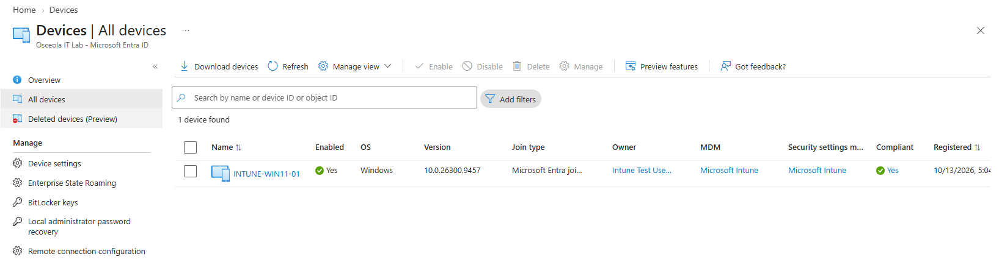
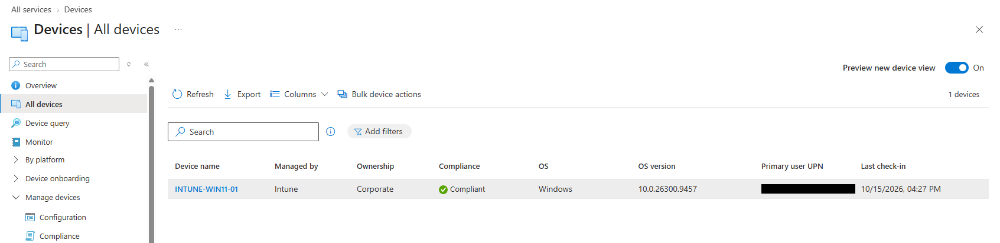
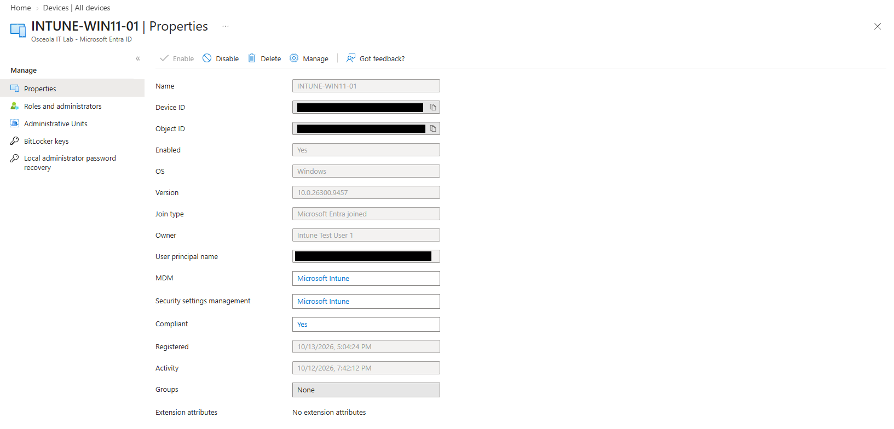
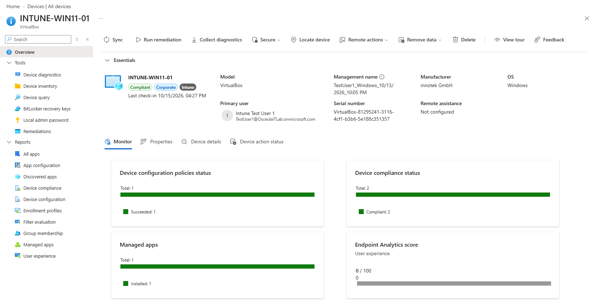

# Device Enrollment & Validation

## Overview

Joined a Windows 11 Pro virtual machine to Microsoft Entra ID and enrolled the device in Microsoft Intune. Verified that the device was successfully joined, managed by Intune, and available for cloud-based configuration policy deployment, application management, and compliance monitoring.

## Environment

* **Hypervisor:** Oracle VirtualBox
* **Operating System:** Windows 11 Pro
* **Device Name:** `INTUNE-WIN11-01`
* **Identity Provider:** Microsoft Entra ID
* **Device Management:** Microsoft Intune
* **Test User:** `testuser1`
* **Security Group:** `SG-Intune-Test-Users`

## Configuration

### Microsoft Entra ID Join

Joined the Windows 11 Pro virtual machine to Microsoft Entra ID to establish the device's cloud identity and enable organizational device management.

*Microsoft Entra admin center displaying the Windows 11 device and its Microsoft Entra joined status.*

### Microsoft Intune Enrollment

Enrolled the Windows 11 device in Microsoft Intune to enable centralized device management, configuration policy deployment, application installation, and compliance evaluation.

*Microsoft Intune admin center displaying the Windows 11 device managed by Intune.*

## Validation

Validated device enrollment by confirming that Microsoft Entra ID recognizes the device as joined and Microsoft Intune recognizes it as a managed endpoint.

### Entra Device Join Validation

Verified the device's join type in the Microsoft Entra admin center.

*Device details displaying the Microsoft Entra joined status.*

### Intune Management Validation

Verified the device's management status in the Microsoft Intune admin center.

*Device details displaying Intune management and the reported compliance status.*

