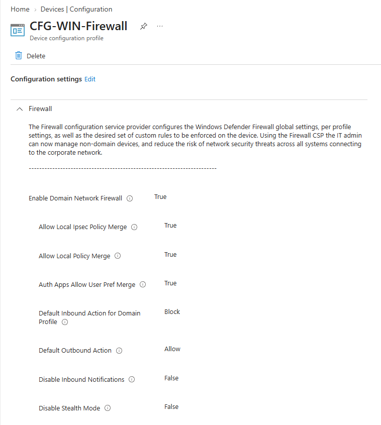
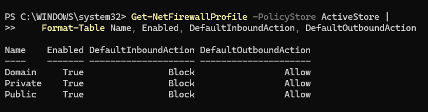

# Firewall Configuration Policy & Validation

## Overview

Created and deployed a Windows firewall configuration policy through Microsoft Intune to manage firewall settings on a Windows 11 Pro device. Configured the Domain, Private, and Public firewall profiles to remain enabled, blocked inbound traffic by default, and allowed outbound traffic by default. Validated the effective firewall settings using PowerShell on the enrolled Windows 11 device.

## Environment

- **Hypervisor:** Oracle VirtualBox
- **Operating System:** Windows 11 Pro
- **Device Name:** `INTUNE-WIN11-01`
- **Identity Provider:** Microsoft Entra ID
- **Device Management:** Microsoft Intune
- **Configuration Policy:** `CFG-WIN-Firewall`
- **Assignment Group:** `SG-Intune-Test-Users`
- **Validation Tool:** PowerShell

## Configuration

### Firewall Configuration Policy

Created a Settings Catalog policy in Microsoft Intune named `CFG-WIN-Firewall` to centrally configure Windows Defender Firewall settings on the enrolled Windows 11 device.

Configured the following settings:

- Enabled the Domain firewall profile.
- Enabled the Private firewall profile.
- Enabled the Public firewall profile.
- Set the default inbound action to Block for all profiles.
- Set the default outbound action to Allow for all profiles.

Assigned the policy to the `SG-Intune-Test-Users` security group.

*Microsoft Intune Settings Catalog policy displaying the configured Windows Firewall settings.*



## Validation

Validated policy deployment through the Microsoft Intune admin center and verified the effective firewall configuration on the Windows 11 device using PowerShell.

### Intune Policy Deployment Status

Checked the device status for `CFG-WIN-Firewall` in Microsoft Intune and confirmed that the policy deployment reported **Succeeded**.

*Microsoft Intune displaying the successful deployment status of the firewall configuration policy.*


### PowerShell Firewall Verification

Ran the following PowerShell command on the Windows 11 device to inspect the effective firewall profile settings:

```powershell
Get-NetFirewallProfile -PolicyStore ActiveStore |
    Format-Table Name, Enabled, DefaultInboundAction, DefaultOutboundAction
```

Verified that the Domain, Private, and Public profiles were enabled, with inbound traffic blocked by default and outbound traffic allowed by default.

Expected output:

| Name | Enabled | DefaultInboundAction | DefaultOutboundAction |
| --- | --- | --- | --- |
| Domain | True | Block | Allow |
| Private | True | Block | Allow |
| Public | True | Block | Allow |

*Windows 11 PowerShell output displaying the effective firewall settings for all three profiles.*


