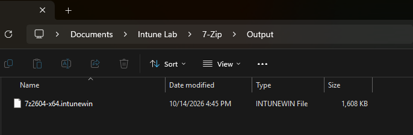
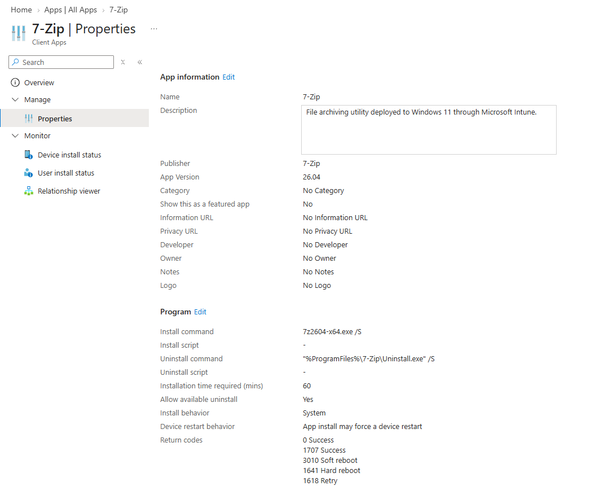
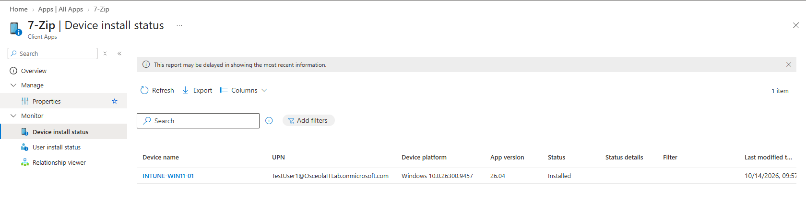
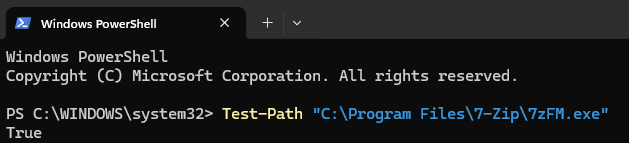

# Application Deployment & Validation

## Overview

Packaged and deployed 7-Zip as a Win32 application through Microsoft Intune to a Windows 11 Pro virtual machine. Used Microsoft's Win32 Content Prep Tool to package the installer into an `.intunewin` file, configured silent installation and application detection, and assigned the application to a test-user security group. Validated the installation locally and confirmed that Microsoft Intune reported the application as Installed.

## Environment

- **Hypervisor:** Oracle VirtualBox
- **Operating System:** Windows 11 Pro
- **Device Name:** `INTUNE-WIN11-01`
- **Identity Provider:** Microsoft Entra ID
- **Device Management:** Microsoft Intune
- **Application:** 7-Zip x64
- **Packaging Tool:** Microsoft Win32 Content Prep Tool
- **Assignment Group:** `SG-Intune-Test-Users`

## Configuration

### Application Packaging

Downloaded the 7-Zip x64 installer and used Microsoft's Win32 Content Prep Tool to package the installer into the `.intunewin` format required for Win32 application deployment through Microsoft Intune.

Configured the source and output directories to organize the installer and packaged application file.

*File Explorer displaying the packaged 7-Zip `.intunewin` application file.*



### Intune Application Configuration

Created a Win32 application in Microsoft Intune and uploaded the packaged 7-Zip installer.

Configured the application with the following settings:

- **Application Name:** `7-Zip`
- **Publisher:** `7-Zip`
- **Install Command:** `7z2604-x64.exe /S`
- **Install Behavior:** System
- **Architecture Requirement:** 64-bit
- **Detection Rule:** File exists
- **Detection Path:** `C:\Program Files\7-Zip`
- **Detection File:** `7zFM.exe`

Assigned the application as Required to the `SG-Intune-Test-Users` security group.

*Microsoft Intune displaying the 7-Zip Win32 application configuration and deployment settings.*



## Validation

Validated application deployment by checking the installation status in Microsoft Intune and verifying the application executable on the Windows 11 device.

### Intune Deployment Status

Reviewed the device installation status for the 7-Zip application in Microsoft Intune and confirmed that the application was reported as **Installed**.

*Microsoft Intune displaying the successful 7-Zip installation status for the Windows 11 device.*



### Local Installation Verification

Used PowerShell on the Windows 11 device to verify that the 7-Zip executable existed at the configured detection path.

```powershell
Test-Path "C:\Program Files\7-Zip\7zFM.exe"
```

The command returned `True`, confirming that the executable was present at the expected location.

*Windows 11 PowerShell output showing the successful 7-Zip executable check.*


