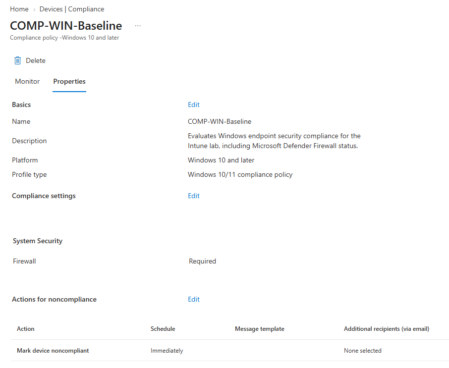
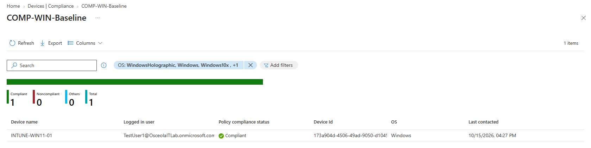

# Compliance Policy & Validation

## Overview

Created and deployed a device compliance policy in Microsoft Intune to evaluate the security status of a Windows 11 Pro virtual machine. Configured the policy to require Windows Firewall to be enabled and assigned it to a test-user security group. Verified that the device was reported as **Compliant** in Microsoft Intune.

## Environment

- **Hypervisor:** Oracle VirtualBox
- **Operating System:** Windows 11 Pro
- **Device Name:** `INTUNE-WIN11-01`
- **Identity Provider:** Microsoft Entra ID
- **Device Management:** Microsoft Intune
- **Compliance Policy:** `COMP-WIN-Baseline`
- **Security Group:** `SG-Intune-Test-Users`

## Configuration

### Microsoft Intune Compliance Policy

Created a Windows compliance policy in Microsoft Intune to evaluate whether Windows Firewall was enabled on the managed device.

Configured the policy with the following settings:

- **Policy Name:** `COMP-WIN-Baseline`
- **Platform:** Windows 10 and later
- **Compliance Setting:** Firewall must be enabled
- **Assignment:** `SG-Intune-Test-Users`

Assigned the policy to the test-user security group so that the enrolled Windows 11 device could be evaluated against the configured compliance requirement.

*Microsoft Intune displaying the compliance policy and its Windows Firewall requirement.*

## Validation

Validated the compliance policy by reviewing the device's compliance status in Microsoft Intune and confirming that the Windows 11 device was reported as **Compliant**.

### Compliance Policy Status

Reviewed the compliance policy status in Microsoft Intune to confirm that the policy was successfully evaluated for the assigned device.

*Microsoft Intune displaying the compliance policy evaluation results.*

### Device Compliance Validation

Verified the device's reported compliance status in the Microsoft Intune admin center. The device reported **Compliant**, indicating that it satisfied the configured Windows Firewall requirement.

*Microsoft Intune device details displaying the Windows 11 device's Compliant status.*

