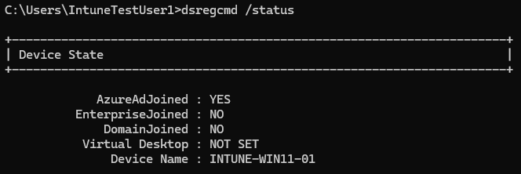

# Troubleshooting & Resolution

## Overview

Investigated and resolved a Windows 11 device enrollment issue encountered while configuring Microsoft Entra ID and Microsoft Intune. The device initially had a work or school account connection without being Microsoft Entra joined, and enrollment error `8018000a` occurred during setup.

Disconnected the existing work or school account connection, verified the device's registration state, and completed the Microsoft Entra ID join and Intune enrollment process. Validated the successful result using Windows diagnostic tools and the Microsoft Intune admin center.

## Environment

- **Hypervisor:** Oracle VirtualBox
- **Operating System:** Windows 11 Pro
- **Device Name:** `INTUNE-WIN11-01`
- **Identity Provider:** Microsoft Entra ID
- **Device Management:** Microsoft Intune
- **Test User:** `testuser1`
- **Security Group:** `SG-Intune-Test-Users`
- **Enrollment Error:** `8018000a`

## Symptoms

During the initial setup, the Windows 11 virtual machine encountered enrollment error `8018000a`. The device had an existing work or school account connection but was not in the intended Microsoft Entra joined state.

The initial device registration status showed:

- **AzureAdJoined:** `NO`
- **WorkplaceJoined:** `YES`

This indicated that the device was workplace registered rather than Microsoft Entra joined.

## Investigation

Used Windows account settings and the `dsregcmd` diagnostic utility to investigate the device's identity and registration state.

Ran the following command in Command Prompt:

```cmd
dsregcmd /status
```

Reviewed the **Device State** section and identified that `AzureAdJoined` was `NO` while `WorkplaceJoined` was `YES`.

This helped establish the device's initial registration state before attempting the intended join and enrollment workflow.

## Resolution

Disconnected the existing work or school account connection through Windows Settings and verified that the previous connection was removed.

After confirming the device was no longer joined or workplace registered, completed the intended Microsoft Entra ID join workflow using the test account.

The device was subsequently enrolled in Microsoft Intune, enabling centralized device management, configuration policy deployment, application installation, and compliance evaluation.

## Validation

Validated the successful resolution by checking the device's Microsoft Entra join status and management status in Microsoft Intune.

### Microsoft Entra Join Validation

Ran the following command on the Windows 11 device:

```cmd
dsregcmd /status
```

Confirmed that the device reported:

- **AzureAdJoined:** `YES`

This verified that the device was Microsoft Entra joined.

*Command Prompt displaying the successful Microsoft Entra join status.*



### Microsoft Intune Management Validation

Opened the Microsoft Intune admin center and verified that the Windows 11 device was recognized as managed by Intune and reported a **Compliant** status.

*Microsoft Intune displaying the enrolled Windows 11 device, its management status, and compliance status.*


## Lessons Learned

- Distinguished Microsoft Entra registered devices from Microsoft Entra joined devices.
- Used `dsregcmd /status` to investigate device identity and join status.
- Verified the device's registration state before retrying enrollment.
- Confirmed successful device joining and Intune management.
- Validated the endpoint's readiness for cloud-based configuration, application deployment, and compliance monitoring.
